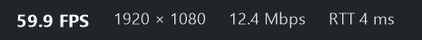

# hu1 display · 晖映

**Turn an Android phone or tablet into a second Windows screen with a USB cable.** Drag a reference document onto your phone to free up your main monitor, or mirror the primary display to show the same thing on both. Video travels over USB, not through the cloud.

[简体中文](README.md) · **English**　｜　[Download for Windows](https://github.com/ya0hu1/hu1-display/releases) · [Quick start](#quick-start) · [Features](#features) · [FAQ](#faq)


*Workspace example: the numbers match the Windows display numbers. The inspector on the right describes the selected display. This is a sample layout.*

## Features

| Feature | What you can do |
| --- | --- |
| Extend or mirror | Move Windows apps onto the phone as a separate display in Extend mode, or show the physical primary monitor in Mirror mode. Mirroring needs no virtual display driver. |
| Independent sessions | Pair each trusted device with a free virtual display and stop one connection at a time. On disconnect, the workspace normally moves ordinary windows back to the physical primary monitor before retiring that virtual desktop. Mirror runs on its own. |
| Display arrangement | Drag the connected virtual display’s number while streaming. Dragging edits a draft; **Apply to Windows** starts a 15-second confirmation window. If you don’t keep the change, the old position returns. Physical monitors stay put. |
| Picture and statistics | Follow the client’s settings, or request 720p / 1080p and 30 / 60 / 90 / 120 fps for an Extend session. Its optional stats overlay has a choice of corner, opacity and compact or detailed view. |
| Android FPS and power | In Mirror or Extend, use the phone’s FPS menu to hide the overlay, show FPS only or see detailed stats. For longer sessions, you can enable **Prefer sustained performance** in the phone settings and reconnect. Android’s thermal limits still apply. |
| Workspace appearance | Switch between English and Simplified Chinese. Preset and custom themes use distinct tones for the primary display, other displays and the selected tile. |
| Portable installation | **Exit & release portable folder** ends this workspace’s sessions without stopping an ADB server shared by other tools or clearing trust and preferences. |


**Extend-only stats overlay** · Compact view shows decoded FPS, negotiated resolution, bitrate and round-trip time. Detail adds the target frame rate and dropped frames. Both examples use the same synthetic data, not benchmark results.




## Quick start

**What you need:** Windows 11 x64 with .NET Framework 4.8, Android 8.0 or later, and a USB data cable. You can explore the workspace without connecting a device.

1. **Download the portable package.** On [GitHub Releases](https://github.com/ya0hu1/hu1-display/releases), choose the version you want and get the portable archive ending in `windows-x64.zip` and its matching `.sha256`, not *Source code (zip)*. Run `Get-FileHash .\hu1-display-*-windows-x64.zip -Algorithm SHA256` in your download folder and compare the hash for that file. Extract the whole archive to a new local folder and open `Hu1.Display.exe`. The Windows executable is unsigned; do not disable system protections.
2. **Connect the phone.** Enable **USB debugging**, connect the cable, unlock the device and verify the RSA prompt. In the workspace, select **Refresh**, choose your device, then **Trust this device**. Android authorization and workspace trust are separate steps.
3. **Prepare the client.** If the matching Android client is not already installed, choose **Connection & setup → Install Android client** and confirm on the phone. The portable package includes the signed hu1 Display client. No separate download is needed, and you can keep the original AnyDisplay app installed.
4. **Choose a desktop and start.** Select **Mirror** to show the primary monitor. For **Extend**, first check **Windows Settings → System → Display** for an available non-primary virtual display (MttVDD), then select it in the workspace. If it is missing, follow the [VDD driver instructions](https://github.com/VirtualDrivers/Virtual-Display-Driver). **Prepare VDD files** does not install a driver; do not reinstall one that already works.

## FAQ

**How do I connect a second device?** Each Extend session needs its own MttVDD slot. Refresh, trust the second device and pair it with a different free display. If there is only one slot, Connection & setup can generate a configuration copy with capacity for 2, 3 or 4. Stop sessions using the driver and back up the original before applying the copy. Follow the driver instructions to reload **only the virtual adapter**. Initially disconnect unused virtual displays in Windows Display settings. The workspace can then activate and retire desktops within that capacity without reloading the driver or taking over a physical screen. Simultaneous use with two real devices has not yet been verified.

**Why is actual FPS lower than my 90 fps target?** The Hz value beside the display map is the **Windows source refresh rate**. The target is a request. The phone overlay counts frames the decoder submits for display each second, not physical panel refreshes. If you explicitly choose 90 or 120 fps and Windows offers that rate at the current resolution, the workspace temporarily switches the selected VDD and restores it on normal stop. The phone may still negotiate a lower rate, and a static desktop can report very low FPS. If the VDD offers only 60 Hz, see the [1080p MttVDD configuration example](docs/vdd-high-refresh.xml) and [hardware measurements](docs/testing.md). There’s no need to change your physical GPU.

**What if a window doesn't come back, or another app needs the virtual display?** Automatic handoff is for ordinary windows. Elevated apps or windows that manage their own position may refuse the move. To share an already-active VDD with another app, clear **Disconnect the selected MttVDD desktop when its session ends** in Preferences before connecting. Standby displays activated by a session are still released. After a forced exit, check the layout in Windows Display settings.

**Why isn’t my phone listed?** Check that the cable carries data, unlock the device, confirm USB debugging authorization, then refresh. The connection uses ADB. Do not root the phone or replace its USB driver with Zadig.

**Which platforms and inputs are supported?** This is a Windows-to-Android USB / H.264 video connection. macOS, HarmonyOS NEXT, wireless streaming, reverse touch or keyboard/mouse input, audio and clipboard sync are not supported. The Android minimum is not a guarantee that every model has been tested.

## Build from source

On a local Windows drive with .NET Framework 4.8, WPF and the framework compiler:

```powershell
git clone https://github.com/ya0hu1/hu1-display.git
cd hu1-display
.\windows-controller\build.ps1
.\bin\Hu1.Display.exe
```

The [build script](windows-controller/build.ps1) compiles the Windows controller only. It does not download dependencies or install drivers. To test streaming, replace `Hu1.Display.exe` in a **separate copy** of a complete portable package. To install the hu1 Display client from a custom Studio build, pass the matching signed APK at build time; see [Android build notes](docs/android-performance.md#rebuild). Without that option, the installer only accepts the pinned upstream APK. If assembling your own package, use the pinned [AnyDisplay engine](https://github.com/efekurucay/anydisplay/releases/tag/v0.1.4) and matching [Google Platform-Tools](https://developer.android.com/tools/releases/platform-tools) (tested: 37.0.3). Preserve the package’s `tools/engine/`, `tools/adb/` and `packages/` directories; the controller checks binary hashes.

[Releases & change history](https://github.com/ya0hu1/hu1-display/releases) · [Tests & measurements](docs/testing.md) · [Third-party notices](THIRD_PARTY_NOTICES.md) · [MIT license](LICENSE)
