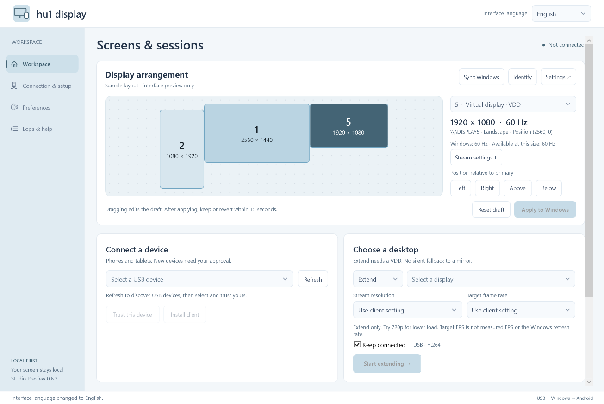
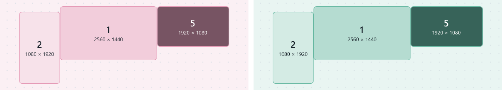
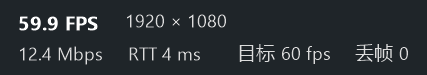

# hu1 display

[简体中文](README.md) · **English**　|　Windows x64 → Android · USB second-screen workspace · [0.6.2 Preview](https://github.com/ya0hu1/hu1-display/releases/tag/v0.6.2-preview)

Use your phone as an independent Windows desktop, or explicitly mirror the primary monitor. The Windows workspace is bilingual and sends video over local USB forwarding, not a cloud service.

[Quick start](#quick-start) · [Stream settings](#stream-settings) · [Compatibility](#compatibility) · [Build from source](#build-from-source) · [Test results](docs/testing.md)



## 0.6.2: move a connected virtual desktop

Once an Extend stream is ready, drag its display number in the map (or use a direction button), then choose **Apply to Windows**. Keep within 15 seconds or the position is restored. A live transaction moves one MttVDD belonging to this workspace, without persisting the active topology or changing its mode. Windows chooses the position when a retired display is enabled again. Physical displays are not movable during streaming. The sidebar, canvas, primary tile and selected display now use distinct tones of the chosen theme, including custom colours.



*One sample layout in two themes. The darkest tile in each is the selected virtual display.*

## 0.6.1: display information at a glance

The compact overlay keeps decoded FPS, the **entire negotiated resolution**, Mbps and RTT on one line when they fit. Detail view adds target FPS and dropped frames. Measurements use the same fonts and DPI as the rendered text; on narrow work areas whole fields wrap instead of clipping digits. Corner and opacity controls remain per Extend session.

**Compact** · decoded frame rate, stream size, bitrate and round-trip time


**Detail** · the same sample, with a 60 fps target and zero dropped frames



The display map now emphasizes Windows display numbers. Its inspector always shows the **source mode and Hz**, distinct from the stream size in the HUD. Controls stack in narrow windows; theme colours are in Preferences. Disconnect, window handoff and portable-folder release are unchanged.

## 0.6: independent desktops

These features are included in the 0.6.2 portable download. Extract it to a new folder rather than replacing a running version.

- Refresh, select another trusted Android and a free MttVDD slot, then start Extend. The session shelf pairs each device with its display. Select a route to stop it or enable its FPS / Mbps / RTT overlay. Choose a corner, compact view and opacity; mirror is exclusive and has no HUD.
- MttVDD 25.7.23 has a fixed **driver capacity**, not a hot-add-per-device API. In Setup, export a 2/3/4-slot copy of the installed configuration. Stop other software using the VDD, back up the original, then manually apply the copy and reload **only the virtual adapter** per its documentation. Disconnect initially unused slots in Windows Display settings. Within that capacity, the workspace activates a selected standby desktop on connection and disconnects it at teardown without restarting the driver.
- By default, a disconnect returns eligible windows to the physical primary display and retires the selected virtual desktop. Clear the retirement option before connecting to an already-active VDD if another app needs it. A session-activated standby slot is always released. Hidden, elevated or self-positioning windows may not move. Check Windows Display settings after a forced exit or a refused change; there is no global topology reset.
- **Exit & release portable folder** in Preferences or the tray stops all local routes. The verified ADB tools run from a user cache outside the extraction folder, with a separate working directory. No global ADB shutdown, preference deletion or cleanup of older running packages.

## Quick start

**Option A — prebuilt Windows portable ZIP (recommended).** [Download 0.6.2 Preview for Windows x64](https://github.com/ya0hu1/hu1-display/releases/download/v0.6.2-preview/hu1-display-0.6.2-preview-windows-x64.zip) · [SHA-256 checksum](https://github.com/ya0hu1/hu1-display/releases/download/v0.6.2-preview/hu1-display-0.6.2-preview-windows-x64.zip.sha256) · [All versions and release notes](https://github.com/ya0hu1/hu1-display/releases). No compiler or Android Studio is required. Choose the named `windows-x64` asset, not GitHub’s automatically generated *Source code (zip)*.

1. Compare `Get-FileHash .\hu1-display-0.6.2-preview-windows-x64.zip -Algorithm SHA256` with the `.sha256` sidecar. Extract the **entire ZIP to a local Windows drive** in a separate folder. Do not run from the archive or a network share.
2. Open `Hu1.Display.exe`. Browsing the workspace needs no phone or driver. The binary is not formally signed; verify its source instead of disabling security protections.
3. Enable **USB debugging** on Android, connect a data-capable cable, unlock the device and verify the RSA prompt. In the workspace click **Refresh**, select your device and **Trust this device**. Android authorization and application trust are separate.
4. If needed, use **Connection & setup → Install Android client** and confirm the installation on your device. The client is the original AnyDisplay v0.1.4, not a separate hu1 display APK.
5. Choose **Extend** and an existing non-primary VDD, or explicitly choose **Mirror** and the physical primary screen. Start the session; stop or exit when finished. The workspace does not automatically connect devices.

### First-time Windows setup

USB transport uses **ADB**, not USB AOA or WinUSB. Do not use Zadig, replace an MTP/GPU driver, root the phone or disable signature checks. Mirror needs no virtual display. For Extend, check **Windows Settings → System → Display** for an enabled, extended Virtual Display Driver / MttVDD monitor. Do not reinstall a working driver. If missing, Connection & setup can open System Protection, prepare the verified driver files and open the manual wizard. Preparing files does **not** install a driver. Follow the applicable [VDD upstream instructions](https://github.com/VirtualDrivers/Virtual-Display-Driver), then refresh. Missing VDD never silently falls back to mirroring.

## Stream settings

Select the **virtual display → Stream settings ↓**, or use **Choose your desktop**. Set the options before starting; stop the session before changing them. These are independent Extend-only requests, not changes to the primary monitor.

| Setting | Choices | Starting point |
|---|---|---|
| Stream resolution | Client setting, 1280 × 720, 1920 × 1080 | 1080p for text; 720p to reduce pixel load |
| Target frame rate | Client setting, 30, 60, 90, 120 fps | 60 for normal use; 30 for lower load; 90/120 when both source and receiver support it |

Both default to preserving Android's request. The engine negotiates with the device, may temporarily switch a supported VDD mode, or scale video to fit. **Windows source Hz**, **negotiated stream target** and **measured Android decoder FPS** are different metrics. A 60 Hz source does not produce 90 distinct desktop frames by requesting 90 fps. A static desktop can legitimately report near-zero FPS.

**High-refresh source:** An explicit 90/120 Extend request temporarily switches only the selected non-primary VDD if Windows exposes that rate at its current desktop size. Normal session cleanup restores the prior rate without writing registry settings. Client default, 30/60, mirror and unsupported rates do not trigger this switch. If the layout changes externally the controller will not overwrite the new settings. After a forced termination, check the VDD under Windows Advanced display. The client may negotiate a lower target.

**Only 60 Hz listed?** For the tested MttVDD 25.7.23 configuration, multiple `<g_refresh_rate>` elements under `<global>` advertise additional rates. The [one-screen 1080p example](docs/vdd-high-refresh.xml) preserves 60 and adds 90/120. Packaged driver preparation still uses conservative defaults. Stop sessions, back up your XML, merge only applicable entries and reload only the matching virtual adapter using its driver instructions. Do not restart physical display adapters. To revert, restore the original XML and reload that VDD.

## Compatibility

| Platform / device | Evidence and scope |
|---|---|
| Windows 11 x64 + .NET Framework 4.8 | WPF controller; USB/H.264 with independent Extend sessions in 0.6; concurrent hardware acceptance pending |
| OPPO Reno7 / Android 13 | 0.5.1: median 59 fps at 1080p/60, 87 fps at 1080p/90 and 720p/90. With a 120 Hz source Reno7 negotiated 90, not 120 fps |
| OPPO Find X8 / ColorOS 16.0.10 / Android 16 | User reports 0.4 works. No separate 0.5 high-FPS benchmark on this model |
| Other Android 8.0+ | Client minimum, not a compatibility certification |
| macOS, HarmonyOS NEXT, wireless | Not supported. Reverse touch/keyboard, audio and clipboard are filtered |

## Build from source

**Option B — customize the controller.** On a local Windows drive with .NET Framework 4.8, WPF and the framework compiler:

```powershell
git clone https://github.com/ya0hu1/hu1-display.git
cd hu1-display
.\windows-controller\build.ps1
.\bin\Hu1.Display.exe
```

You can give the repository URL to a coding assistant and ask it to follow the build script. It builds only the controller, downloads nothing and installs no driver. Do not bypass local execution policy. Rust, CMake and Android Studio are not required for this build.

For streaming, replace the EXE in a separate copy of a complete portable package, or obtain the pinned Windows CLI and APK from [AnyDisplay v0.1.4](https://github.com/efekurucay/anydisplay/releases/tag/v0.1.4) and the matching Windows [Google Platform-Tools](https://developer.android.com/tools/releases/platform-tools) (tested: 37.0.3). Put `anydisplay-win.exe` in `tools/engine/`; put `adb.exe`, `AdbWinApi.dll` and `AdbWinUsbApi.dll` in `tools/adb/`; put `AnyDisplay-v0.1.4.apk` in `packages/`, all relative to the EXE. `packages/VirtualDisplayDriver/` is optional for manual driver preparation. Do not substitute unverified binaries: hashes are checked before use.

Sources: `windows-controller/src/`. Tests: `windows-controller/tests/`. The local controller build goes to `bin/`; local Windows ZIPs and their checksums go to `dist/windows/`, not Git.

**Troubleshooting:** If the phone is missing, check the data cable, lock screen and RSA prompt, then refresh. If 90 fps looks like 60, compare the VDD's available rates with the negotiated target and decoder stats before changing settings. Exit the app before removing its portable folder; `%LOCALAPPDATA%\DeskLinkStudio` holds separate local trust and preferences. Do not attach device identifiers, credentials or raw session logs to issues.

[Tests & measurements](docs/testing.md) · [Third-party notices](THIRD_PARTY_NOTICES.md) · [MIT license](LICENSE).
