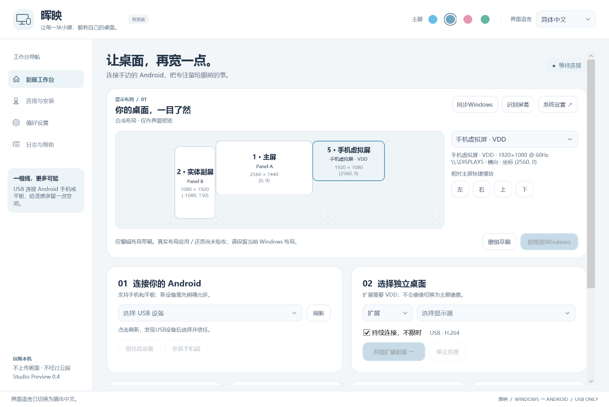

# 晖映

**简体中文** · [English](README.en.md)　｜　Windows 工作台 · 0.4 源码预览

通过 USB，把手边的 Android 手机或平板用作 Windows 副屏。工作台负责选择设备、查看显示布局、开始和停止会话；画面通过本机 ADB 转发，不经过云端。



*此图由工作台渲染，使用合成布局，没有采集真实桌面或手机内容。*

## 界面与语言

右上角的 **界面语言** 可选「简体中文」或「English」。首次打开时，中文 Windows 默认显示「晖映」，其他语言默认显示「hu1 display」。选择立即生效并记在本机，下次打开沿用；不需要断开会话或丢弃布局草稿。原版 Android 客户端、Windows 系统弹窗及历史日志不会被重新翻译。

- **副屏工作台**：画布区分主屏、实体副屏与虚拟屏；拖动只编辑草稿。可选择已有的非主屏 VDD 进行扩展，也可明确选择主屏镜像，两者不会自动互换。
- **连接与安装**：手动刷新 USB 设备，核对并信任后才能安装客户端或连接。启动工作台本身不会扫描手机或安装驱动。
- **偏好与设备**：切换四种预设配色或自选颜色，管理设备信任与昵称。语言、主题和信任记录仅保存在此电脑。
- **日志与帮助**：查看会话状态和诊断信息。FPS、码率与 RTT 取自实际采样，尚无样本时显示「—」。

## 从源码打开工作台

在 **Windows 11 x64 本地磁盘**检出仓库，使用已有的 .NET Framework 4.8 与 WPF 组件。在仓库根目录运行：

```powershell
.\windows-controller\build.ps1
.\bin\Hu1.Display.exe
```

构建仅生成控制端，不下载其他软件。若系统策略不允许执行脚本，请先核对策略，不要为此关闭系统防护。

**要查看界面，不需要手机或驱动。要传输画面，则另需：** Android 8.0+、数据线、USB 调试授权、与控制层校验值匹配的 AnyDisplay v0.1.4 引擎和 APK、Google ADB 及配套 DLL。默认相对路径为 `tools/engine/anydisplay-win.exe`、`tools/adb/` 和 `packages/AnyDisplay-v0.1.4.apk`（均相对于 EXE）。扩展模式还需要已有的非主屏 VDD。连接前请核对设备并手动刷新；此版过滤触控、音频和剪贴板回传。

## 发布与验证范围

这是**控制层源码预览**，不是开箱即用的便携包。公开仓库不附带 EXE、APK、ADB、驱动、上游源码镜像或任何个人运行资料。上游版本和许可见[第三方说明](THIRD_PARTY_NOTICES.md)。

本版在 Windows 上编译并通过 **93 项策略、21 项合成布局、10 项 WPF 自测**；用合成数据渲染了中英文全部四页。[复现步骤](docs/testing.md)。本轮未连接真实手机、未安装驱动，也未验收真实显示布局的应用及还原。**建议保留现有 Windows 布局，不使用「应用到 Windows」**。不承诺持续帧率、端到端延迟或跨机型兼容性。

控制层采用 [MIT License](LICENSE)。反馈时请勿附上设备序列号、信任文件、配对密钥或未经脱敏的日志。
