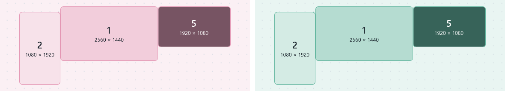
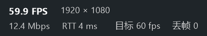

# 晖映 · hu1 display

**用一根 USB 数据线，把 Android 手机或平板变成 Windows 的第二块屏幕。** 把参考资料拖到手机上，让主屏留给手头的工作；也可以选择镜像，让两块屏幕显示同一份内容。视频通过本机 USB 传输，不经过云端。

**简体中文** · [English](README.en.md)　｜　[下载 Windows 便携包](https://github.com/ya0hu1/hu1-display/releases) · [快速上手](#快速上手) · [功能特色](#功能特色) · [常见问题](#常见问题)


*工作台示例：编号对应 Windows 显示器，右侧显示选中屏幕的信息。图中使用合成布局。*

## 功能特色

| 功能 | 可以怎么用 |
| --- | --- |
| 扩展或镜像 | 扩展时，手机是可以拖入窗口的独立桌面；镜像时，它显示实体主屏，不需要虚拟显示驱动。 |
| 多屏会话 | 为每台受信任的设备选择一个空闲虚拟屏，可单独停止某一路连接。断开时，默认先把该屏上的普通窗口迁回实体主屏，再停用虚拟桌面。镜像独占，不与扩展同时运行。 |
| 屏幕排列 | 传输中也能拖动已连接虚拟屏的编号。拖动只改草稿；点「应用到 Windows」后有 15 秒确认，未保留就自动还原。不会移动实体屏。 |
| 画质与统计 | 扩展模式可跟随手机设置，或指定 720p / 1080p、30 / 60 / 90 / 120 fps 的目标。仅在扩展屏显示的统计小窗可选角落、透明度以及紧凑或详细视图。 |
| 工作台外观 | 可切换简体中文与英语，选择预设或自定义配色。排列图用同一主题的不同明暗区分主屏、其他屏和当前选中屏。 |
| 便携退出 | 「退出并释放便携目录」会结束本工作台的会话，不会强制停止其他调试工具共用的 ADB，也不清除设备信任或偏好。 |



**副屏统计小窗** · 紧凑视图显示实际解码帧率、协商分辨率、码率和往返延迟；详细视图另列目标帧率和累计丢帧。下图为同一组合成数据，不是设备跑分。




## 快速上手

**准备：** Windows 11 x64（.NET Framework 4.8）、Android 8.0 或更高版本，以及支持数据传输的 USB 线。只看工作台界面不需要连接设备。

1. **下载便携包。** 从 [GitHub Releases](https://github.com/ya0hu1/hu1-display/releases) 选择要使用的版本，下载该版本以 `windows-x64.zip` 结尾的便携包 和同名 `.sha256`，不要选 *Source code (zip)*。在下载目录运行 `Get-FileHash .\hu1-display-*-windows-x64.zip -Algorithm SHA256`，核对对应文件的哈希。将整个 ZIP 解压到新的本地目录，双击 `Hu1.Display.exe`。预览包未正式签名，不要关闭系统防护。
2. **连接手机。** 打开 Android 的「USB 调试」，接线并解锁，核对手机上的 RSA 授权提示。回到工作台点「刷新」，选择自己的设备，再点「信任此设备」。手机授权和工作台信任是两步。
3. **准备客户端。** 若手机尚未安装匹配的 AnyDisplay，在「连接与安装」点「安装手机端」，并在手机上确认。客户端沿用上游名称，不叫“晖映”。
4. **选择桌面并开始。** 只看主屏就选「镜像」。要扩展，先在 **Windows 设置 → 系统 → 显示** 确认可用的非主屏虚拟显示器（MttVDD），再在工作台选「扩展」和目标屏。没有虚拟屏时，请按 [VDD 官方说明](https://github.com/VirtualDrivers/Virtual-Display-Driver) 手动准备驱动；工作台的「准备 VDD 文件」不会替你安装驱动。已有可用虚拟屏无需重装。

## 常见问题

**如何接第二台设备？** 每个扩展会话需要单独的 MttVDD 槽位。刷新并信任第二台设备，为它选择不同的空闲屏幕即可。若只有一个槽位，在「连接与安装」可生成容量为 2、3 或 4 的配置副本。先停止使用该驱动的会话，备份原配置，再按驱动说明应用副本并只重载虚拟适配器。首次在 Windows 显示设置中断开闲置虚拟屏，此后工作台按会话启停，不会热重载驱动或占用实体屏。双机并发仍待实机验证。

**为什么目标选了 90 fps，画面却不到 90？** 排列图旁的 Hz 是 **Windows 源刷新率**，目标帧率是请求，统计小窗的 FPS 才是 **手机实际解码帧率**。明确选择 90 或 120 fps 时，若 Windows 在当前分辨率提供该刷新率，工作台会临时切换所选虚拟屏，正常停止后还原。手机仍可能协商到更低帧率，静止桌面的 FPS 也可能很低。如果虚拟屏只列出 60 Hz，可对照 [MttVDD 的 1080p 配置示例](docs/vdd-high-refresh.xml) 和[实机测试记录](docs/testing.md)，不必更改实体显卡。

**断开后找不到窗口，或另一款软件还需要虚拟屏？** 默认的窗口迁回适用于普通应用，提权或自行控制位置的窗口可能不接受移动。若其他软件还要使用一块已经启用的虚拟屏，连接前可在偏好设置取消「断开时停用所选 MttVDD 桌面」。由本次会话从待机启用的屏幕仍会释放。异常退出后可到 Windows 显示设置核对布局。

**手机未出现？** 确认线缆能传数据，解锁并检查 USB 调试授权，然后刷新。这里使用 ADB，不需要 Root，也不要用 Zadig 替换手机的 USB 驱动。

**支持哪些平台和输入？** 当前是 Windows 到 Android 的 USB / H.264 画面传输，不支持 macOS、HarmonyOS NEXT、无线传输、手机触控或键鼠回传、音频及剪贴板同步。Android 版本达到最低要求不等于每台设备都已验证。

## 从源码构建

在 Windows 本地磁盘使用 .NET Framework 4.8、WPF 及对应编译器：

```powershell
git clone https://github.com/ya0hu1/hu1-display.git
cd hu1-display
.\windows-controller\build.ps1
.\bin\Hu1.Display.exe
```

[构建脚本](windows-controller/build.ps1)只编译 Windows 控制端，不下载依赖或安装驱动。要测试传输，可在完整便携包的**独立副本**里替换 `Hu1.Display.exe`。自行组装时需使用匹配的 [AnyDisplay 引擎与 APK](https://github.com/efekurucay/anydisplay/releases/tag/v0.1.4) 和 [Google Platform-Tools](https://developer.android.com/tools/releases/platform-tools)（已验证 37.0.3）；保留便携包的 `tools/engine/`、`tools/adb/` 和 `packages/` 目录结构，工作台会核对二进制哈希。

[版本发布与更新记录](https://github.com/ya0hu1/hu1-display/releases) · [测试方法与结果](docs/testing.md) · [第三方来源](THIRD_PARTY_NOTICES.md) · [MIT 许可](LICENSE)
